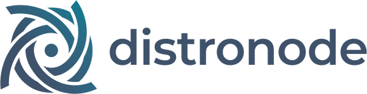

<picture>
  <source media="(prefers-color-scheme: dark)" srcset=".github/assets/distronode-logo-dark.png">
  <source media="(prefers-color-scheme: light)" srcset=".github/assets/distronode-logo-light.png">
  
</picture>

# District AI for Mac

[](https://scorecard.dev/viewer/?uri=github.com/distronode-corporation/district-macos)
[](https://www.bestpractices.dev/projects/15871)
[](https://github.com/distronode-corporation/district-macos/releases/latest)

<a href="https://apps.apple.com/app/id6809297970?platform=mac"></a>

The native macOS client for [District AI](https://www.distronode.com/district-ai), the AI
receptionist service by Distronode. It matches the iPad app section for section: calls
placed and answered on the Mac, the inbox, contacts, meeting rooms and the settings of a
District AI workspace.

**Links:** [project page](https://www.distronode.com/open-source/district-macos),
[GitLab mirror](https://gitlab.com/distronode-corporation/district-macos) (read-only
mirror; issues and pull requests live on GitHub), [CHANGELOG](CHANGELOG.md).

**Status:** the release badge above names the current release, a signed, notarised download on
[Releases](https://github.com/distronode-corporation/district-macos/releases/latest) and through Homebrew
(`brew install distronode-corporation/tap/district-ai`). It is also on the
[Mac App Store](https://apps.apple.com/app/id6809297970?platform=mac), where a new version can arrive later while Apple reviews it.
It has every section of the iPad app: it signs in, shows the Overview, the Inbox, Calls, Contacts and
the workspace's sections (District HQ, Analytics, Billing, Phone numbers, Workflows, Desk,
Support, Scheduling and Workspace settings), places calls from Dial, joins Rooms, and rings
for calls handed to you and answers them. See [CHANGELOG.md](CHANGELOG.md).

**How calls reach a Mac.** While you are signed in, a call handed to you rings on this
Mac: a small call window, a notification with Answer and Decline, and a ring. Closing the
window does not stop it: District AI stays in the menu bar (Open District AI, Open at
Login, Quit) and keeps ringing. Turn ringing off with Ring on this computer (in Account,
and in Settings). When the app is quit, calls handed to you still ring on your other
signed-in devices. A native Mac app cannot use CallKit or VoIP push, which is why the app
stays running.

This repository is the client's complete source, under the Apache License 2.0. The
District AI service it talks to is not open source; signing in needs a District AI
account. Without one you can still build the app and run its unit tests.

**Without an account with us.** Today this app needs a District AI account to sign in. We
want the District AI apps to work without an account with us too. We have not worked out
what that looks like or whether it can work, and the answer depends on what people would
use them with, so we are asking before we build anything:
[tell us what you would connect them to](https://github.com/distronode-corporation/.github/discussions/1).

SwiftUI, Swift 6 language mode, macOS 14 Sonoma and later, one universal app for Apple
silicon and Intel Macs.

**Languages:** English and Canadian French (fr-CA), from 3.0.0. A Mac whose languages put
any French first (Canada, France, Belgium, Switzerland) reads Canadian French; any other
Mac reads English.

## Two ways to install it

- **A direct download** from [Releases](https://github.com/distronode-corporation/district-macos/releases/latest): a Developer ID
  signed and notarised `.dmg`, which keeps itself up to date with
  [Sparkle](https://sparkle-project.org). The same build is in our Homebrew tap:
  `brew install distronode-corporation/tap/district-ai`.
- **The Mac App Store:** [District AI on the Mac App Store](https://apps.apple.com/app/id6809297970?platform=mac). The Mac app
  shares its App Store record with District AI for iPhone and iPad, so it is one
  purchase across all three, and the App Store updates it. A new version can reach the
  store later than the direct download while Apple reviews it.

**Install one, not both.** The two builds are the same app (one bundle identifier), so
they share their settings, their saved session and the `districtai://` links; installed
side by side, either one may answer a link or a notification.

## Requirements

- macOS with **Xcode 26.3** (CI selects exactly this version)
- **XcodeGen 2.46** or newer (the Xcode project is generated from `project.yml`)
- Deployment target **macOS 14.0**
- For linting: **SwiftFormat 0.63.0** and **SwiftLint 0.65.1**, the versions CI pins

The models, API client, repositories and auth logic live in
[district-core-swift](https://github.com/distronode-corporation/district-core-swift),
the core shared with the iOS app, which builds and tests on Linux too.

## Build and test

```sh
xcodegen generate --spec project.yml

# The Mac App Store target, and the Developer ID target (the same app plus Sparkle).
# Both build "District AI.app", so the second build replaces the first in the products
# directory. Signed ad hoc: the project carries no team, certificate or provisioning profile.
for scheme in DistrictMac DistrictMacDirect; do
  xcodebuild build -project DistrictMac.xcodeproj -scheme "$scheme" \
    -destination 'platform=macOS' \
    CODE_SIGN_IDENTITY=- CODE_SIGN_STYLE=Manual DEVELOPMENT_TEAM=
done

# The unit tests, with the ad-hoc entitlements (see below).
xcodebuild test -project DistrictMac.xcodeproj -scheme DistrictMac \
  -destination 'platform=macOS' \
  CODE_SIGN_IDENTITY=- CODE_SIGN_STYLE=Manual DEVELOPMENT_TEAM= \
  CODE_SIGN_ENTITLEMENTS="$PWD/App/AdHoc.entitlements"
```

Two things that are expected, not broken:

- **An ad-hoc build carrying the real entitlements will not launch.** Push, Sign in with
  Apple, associated domains and the keychain group must come from a provisioning
  profile, and macOS refuses to start an ad-hoc signed app that claims them. To run the
  app or its tests without our signing team, sign it with
  [`App/AdHoc.entitlements`](App/AdHoc.entitlements) (the sandbox and device keys only),
  as the test command above does. The absolute path matters: a relative one is resolved
  inside each Swift package too.
- **Such a build stops at "Try again", not "Sign in".** Without the keychain group the
  app cannot read the keychain, so it cannot tell whether a session exists.

### Lint and hygiene

From the repository root:

```sh
swiftformat --lint .
swiftlint --strict
python3 scripts/check-public-hygiene.py --self-test
python3 scripts/check-public-hygiene.py
```

The hygiene check fails on an em or en dash, an internal host name or a GitLab URL
anywhere in the tree. The one GitLab URL it allows is this repository's own mirror.

## Repository layout

```
App/
  Sources/              The SwiftUI app, compiled into both targets: Navigation/ (the
                        sidebar, routes and menu commands), Features/<Name>/,
                        DesignSystem/, Session/, Platform/ (push, Sentry, AppKit,
                        Calls/ for the LiveKit engine and audio devices, Live/ for
                        the telemetry socket and ringing)
  Direct/               Sparkle. Compiled into DistrictMacDirect only
  Resources/            The notification strings
  Tests/                DistrictMacTests
  UITests/              DistrictMacUITests: the store screenshots, run by hand on a
                        Mac and never in CI (docs/screenshots.md)
  PrivacyInfo.xcprivacy The App Store privacy manifest
  AdHoc.entitlements    The entitlements an ad-hoc build is signed with
project.yml             The XcodeGen spec: this is the project; the .xcodeproj is
                        generated and never committed
docs/screenshots.md     How the Mac App Store screenshots are taken
PORTING.md              Which district-ios commit each ported screen came from
scripts/                The release toolchain (archive, Developer ID packaging,
                        Sparkle signing, App Store Connect upload and submission)
                        with its tests, and the public-hygiene check
```

`App/DistrictMac.entitlements` and `App/DistrictMacDirect.entitlements` are written by
`xcodegen generate` from `project.yml`; edit the spec, not the files.

## Continuous integration

[`.github/workflows/ci.yml`](.github/workflows/ci.yml) runs on every push to `main` and
every pull request, and uses no secrets:

- **lint** (Linux): SwiftFormat and SwiftLint.
- **hygiene** (Linux): the public-hygiene check and its self-test, and the licence files.
- **gitleaks** (Linux): the full git history, with [`.gitleaks.toml`](.gitleaks.toml).
- **zizmor** (Linux): static analysis of the workflows.
- **app** (macOS, Xcode 26.3): generates the project, builds both targets, builds the
  store target for testing and runs `DistrictMacTests`.
- **dependency graph** (Linux): submits the Swift packages **app** resolved to GitHub's dependency graph,
  which cannot see them on its own; on pushes to `main` and pull requests from this
  repository.
- **dependency-review** (Linux, pull requests): fails a pull request that adds a
  dependency with a known moderate-or-worse vulnerability or a licence this project cannot
  ship, compared after the snapshot above has landed.

[`codeql.yml`](.github/workflows/codeql.yml) runs CodeQL over the workflows on every
pull request, and [`codeql-swift.yml`](.github/workflows/codeql-swift.yml) over the app's
own Swift build nightly and on demand (LiveKit, Sentry, Sparkle and DistrictCore are built
before the trace starts, so they are not analysed here; DistrictCore is analysed in its own
repository). [`scorecard.yml`](.github/workflows/scorecard.yml) publishes the OpenSSF Scorecard result behind the badge above.

## Releases

3.0.3 (build 20077) is the current release, on [Releases](https://github.com/distronode-corporation/district-macos/releases/latest) and
in the Homebrew tap. It is on the Mac App Store too, where a new version can arrive later while Apple reviews it.
[`release.yml`](.github/workflows/release.yml) builds both builds of one commit
on GitHub-hosted macOS runners, from `main` or a protected `v*` tag, with no signing key
or store credential stored in this repository or in GitHub (each run borrows them from
Distronode's Google Cloud for its own length):

- the Mac App Store build is signed and uploaded to App Store Connect for TestFlight;
- the Developer ID build is notarised and stapled, packed into a signed, notarised and
  stapled `.dmg`, signed for Sparkle, and kept with its checksums and a build provenance
  attestation as the run's artifact.

Submission to the App Store ([`submit.yml`](.github/workflows/submit.yml)) and publishing
the `.dmg` here ([`publish.yml`](.github/workflows/publish.yml)) happen only with the
maintainers' explicit approval. Publishing checks the build (checksums, the Sparkle
signature against the key in `project.yml`, the provenance attestation), makes it an
immutable GitHub Release with the `.dmg`, its `.sig`, `SHA256SUMS` and the attestation
bundle (`.intoto.jsonl`), and adds it to the Sparkle appcast at
<https://updates.distronode.com/district/macos/appcast.xml>, kept in
[distronode-corporation/updates](https://github.com/distronode-corporation/updates). Its
`dry_run` does all of that except the Release and the appcast push. Verify a download
with `gh attestation verify DistrictAI-<version>-<build>.dmg --repo distronode-corporation/district-macos`.
Builds from a fork report no crashes: crash reporting (Sentry) starts only when a DSN is supplied at build
time, and `project.yml` ships it empty.

What's New is the version's `CHANGELOG.md` section for English and
`release-notes/<locale>/<version>.txt` (for example `release-notes/fr-CA/2.0.txt`, plain text
exactly as the store shows it) for every other language, as on district-android. A
localization in a language with no notes stops the submission; English is never sent in its
place. When the store's readers come from an older version than that section assumes (Mac
3.0.0 was never on the Mac App Store, so its readers go from 2.0.1 to 3.0.1),
`release-notes/<locale>/<version>-mas.txt`, English in `release-notes/en-US/`, replaces every
language's notes for the store only; it is all languages or none, and the GitHub Release keeps
the CHANGELOG section.

`store-listing/<locale>.json` (en-US and fr-CA) is the reviewed Mac App Store listing: name,
subtitle, description, keywords, promotional text, and the support and marketing URLs, in
district-ios's format. It is entered in App Store Connect by hand for the Mac App Store,
copied from these files and never retyped; no script uses them yet. The subtitle is one
app-level field shared with iPhone and iPad, so fr-CA's subtitles are district-ios's, and
the one that applies translates the live English subtitle.

## Contributing, security and conduct

- [CONTRIBUTING.md](CONTRIBUTING.md): the local gate and the rules CI enforces.
- [SECURITY.md](SECURITY.md): report vulnerabilities privately, not in an issue.
- [CODE_OF_CONDUCT.md](CODE_OF_CONDUCT.md).
- [SUPPORT](.github/SUPPORT.md): where questions, bugs and account problems go.
- [CHANGELOG.md](CHANGELOG.md).

Questions about a District AI account, number or bill go to
[District AI support](https://www.distronode.com/support).

## License and trademarks

Apache License 2.0. See [LICENSE](LICENSE) and [NOTICE](NOTICE).

District AI, Distronode and the District AI and Distronode logos and app icons are
trademarks of Distronode Corporation. They are not licensed under the Apache License 2.0:
a build you distribute must use its own name, icon and bundle identifier.

Apple, the Apple logo and Mac are trademarks of Apple Inc., registered in the U.S. and other
countries. Mac App Store is a service mark of Apple Inc.
